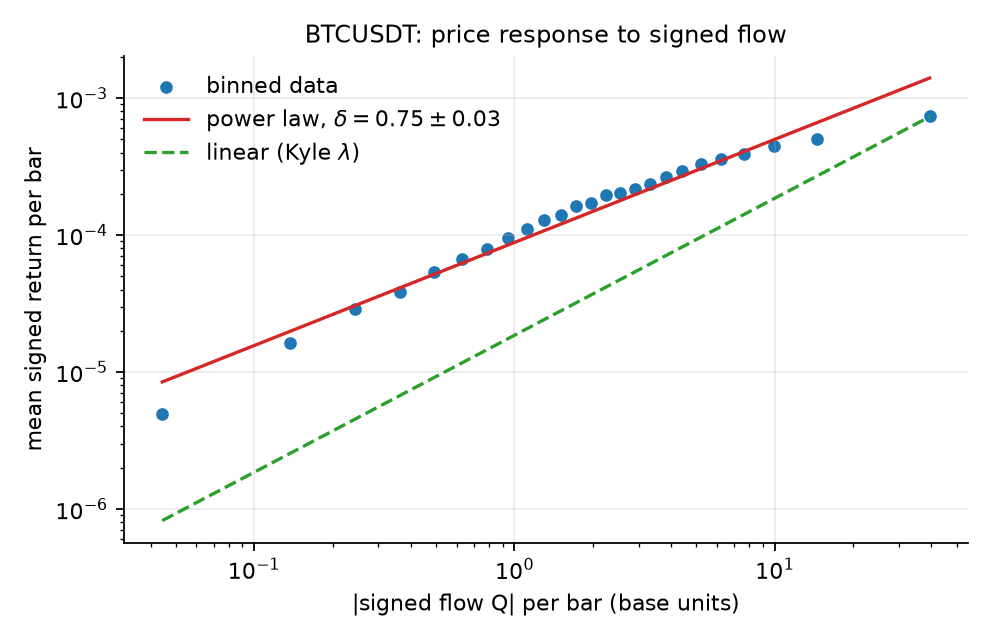
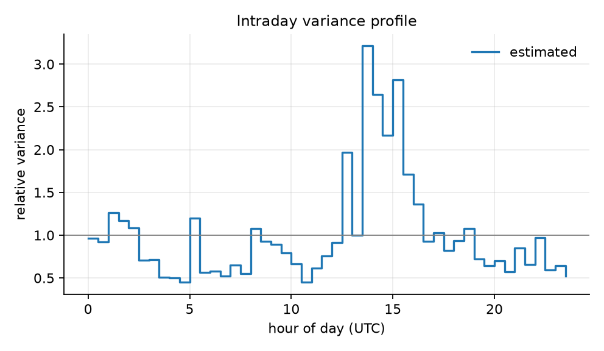
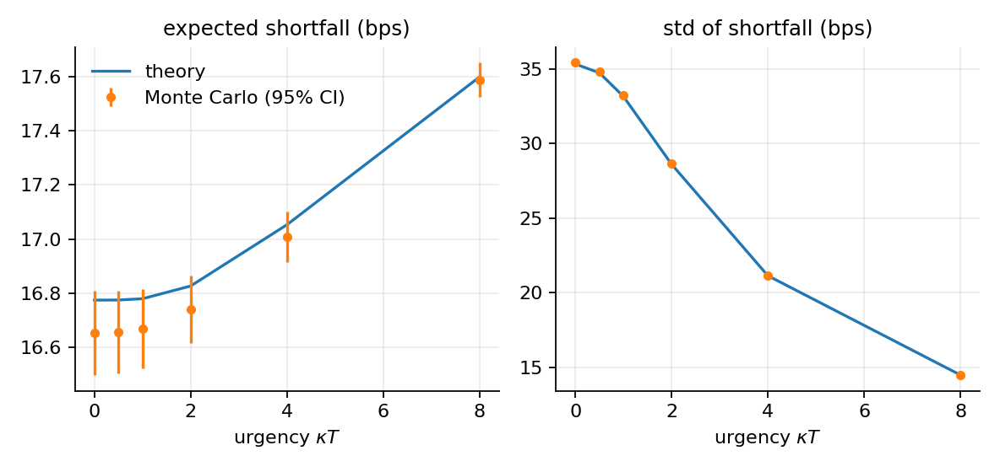
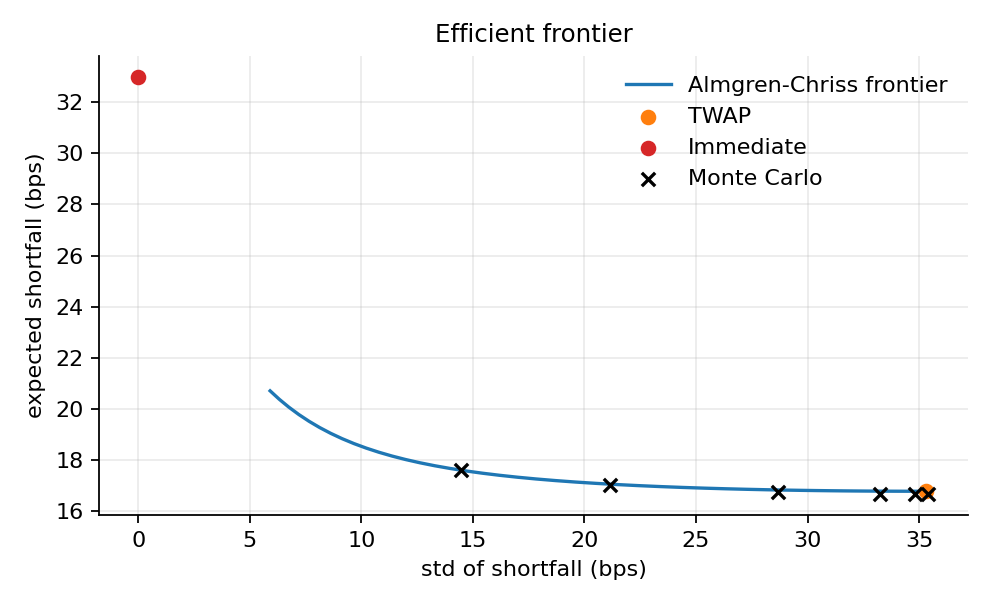
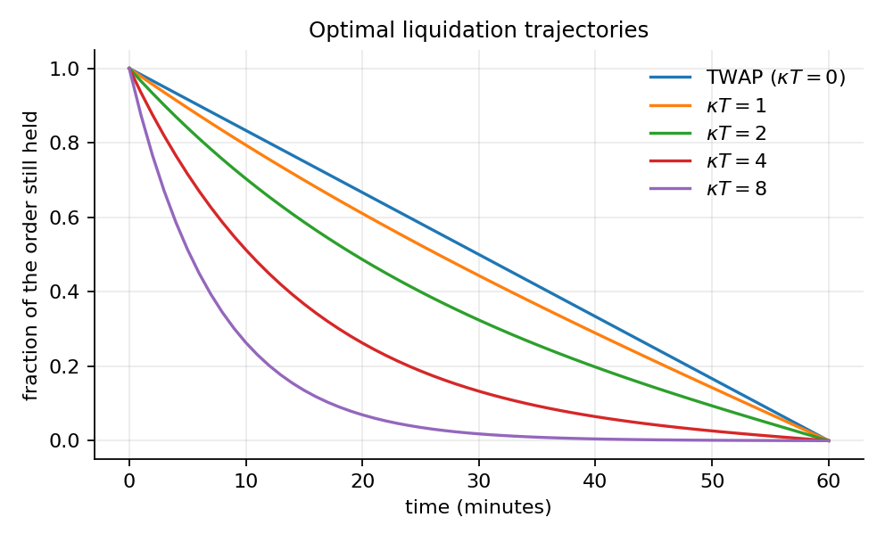
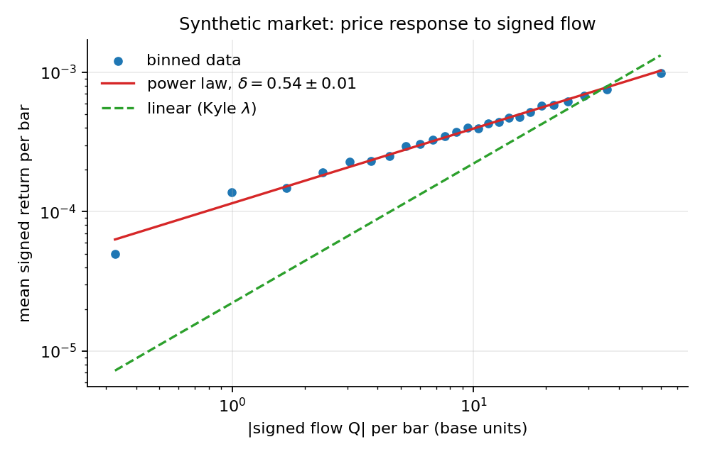
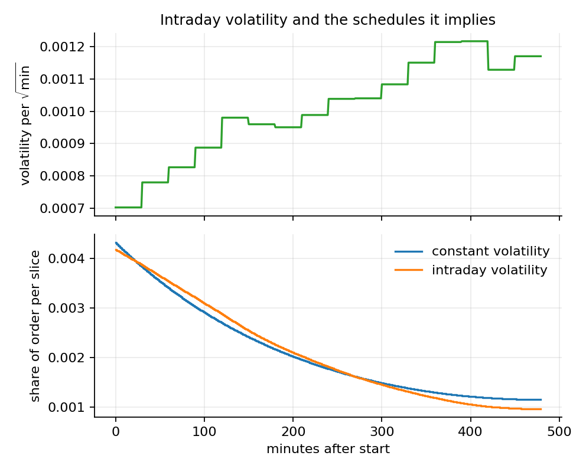

# Optimal Trade Execution: the Almgren-Chriss Model, Tested on Market Data

A Python implementation of the **Almgren-Chriss** framework for liquidating a large order, together with the tools to confront its assumptions with real data: Monte Carlo verification, calibration of market impact and volatility from 1-minute bars, and volatility forecasting (GARCH written from scratch).

When selling $X$ shares by time $T$, selling fast costs more in market impact, while selling slowly leaves the position exposed to price moves. The model finds the schedule that minimises *expected cost + λ × variance*.

## What the project does

1. **Computes the optimal schedule** in closed form, the efficient frontier, and a version for time-varying volatility (`optexec.ac`).
2. **Verifies it** against Monte Carlo simulation and against a generic numerical optimiser (`optexec.simulate`, `tests/`).
3. **Calibrates the model's assumptions on data** (`optexec.calibration`, `optexec.volatility`): is impact linear in order flow or concave? how much of it is temporary? does volatility change during the day? are GARCH forecasts better than a constant?
4. **Runs on real data**: Binance BTCUSDT 1-minute klines, in `data/raw/`.

The mathematics is derived in [`docs/theory.md`](docs/theory.md).

## Quick start

```bash
pip install -r requirements.txt
python -m pytest -q                              # tests
python scripts/run_validation.py                 # study on a simulated market (truth known)
python scripts/run_real_data.py --symbol BTCUSDT # study on the data in data/raw -> results/
```

To fetch other months or another symbol: `python scripts/download_binance.py --symbol ETHUSDT --interval 1m --start 2026-07 --end 2026-09`.

## Findings on real data

BTCUSDT 1-minute klines from Binance (source: [data.binance.vision](https://data.binance.vision)), 1 July to 30 September 2026: 132,480 bars. The full output is in [`results/summary.md`](results/summary.md).

**Impact is concave, not linear.** The mean price response grows roughly as the 0.75 power of the net order flow per minute (exponent 0.75 ± 0.03), clearly below the value 1 that the model assumes. This is not the 0.5 "square-root" shape either. On simulated data with a true exponent of 0.50 the same estimator returned 0.54, so it is slightly biased upwards and the real exponent may be a little lower.

**The temporary part of impact is not identifiable at one minute.** Only about 3% of the contemporaneous impact reverses in the next minute. The estimated temporary impact therefore violates the model's own condition η > γτ/2, and the Almgren-Chriss figures below use an *assumed* temporary impact, not a measured one. Whether impact reverses more slowly than one minute was not tested.

**Volatility is far from constant.** The variance differs by a factor of about 7 between the most and the least volatile half-hours of the day. Out of sample, GARCH(1,1) forecasts the 60-minute variance better than EWMA, and both far better than a constant (QLIKE 0.29, 0.38 and 0.52). The estimated GARCH persistence is 0.9999, so the fitted process is close to non-stationary.

**Effect on the schedule (conditional on the assumed temporary impact).** For an order of 33.6 BTC, 10% of the median volume over one hour, Almgren-Chriss with κT = 2 lowers the standard deviation of the shortfall from 21.4 to 17.3 bps and the 95% CVaR from 47.6 to 39.2 bps, at the same mean cost (3.0 bps). For an 8-hour order, following the intraday volatility profile lowers the controllable part of the cost by 0.6% to 4.1%, depending on the start time.

<p float="left">
  
  
</p>

*Left: binned price response to signed order flow on real data, with the power-law fit and the linear (Kyle λ) fit. Right: intraday variance profile.*

## Validation on simulated data

The code is first tested on a market whose true parameters are known (full tables in [`docs/validation_results.md`](docs/validation_results.md)).

**Theory against Monte Carlo.** The closed-form expected cost and variance match 200,000-path simulations: z-scores within ±1.6, standard deviations within 0.3%.



**Frontier and trajectories.** More urgency (larger κT) front-loads the sale and lowers the variance at a small cost in expected shortfall.

<p float="left">
  
  
</p>

**Recovering the market's parameters.** On 90 simulated days the true impact exponent is 0.50 and the estimate is **0.536 ± 0.012**: close, but off by about three standard errors, a reminder that binning and the temporary-reversion term add bias beyond sampling noise. The temporary share of impact is recovered almost exactly (0.500 against 0.500) and the intraday variance profile correlates 0.98 with the truth. On the binned data, the linear model visibly misses the curvature (see figure), and the estimated exponent is far from the value 1 that a linear impact would give.



**Volatility forecasts.** Out of sample, GARCH(1,1) and EWMA forecast the 60-minute variance far better than a constant (QLIKE 0.108 and 0.124 against 0.414). GARCH recovers the true parameters on simulated GARCH data (`tests/test_volatility.py`).

**Intraday volatility.** For an 8-hour order, following the volatility pattern lowers the controllable part of the objective by 2.8% (quiet start) and 0.3% (volatility rising): a real but small gain.



> These results validate the *code*: the market is simulated, so the truth is known. They say nothing about real markets; for that, see the findings above.

## Limitations

* **Impact is not identified from public bar data.** Regressing returns on aggregate signed flow mixes the price impact of trades with the information they carry. The estimates indicate the *shape* and order of magnitude of impact, not the cost of one trader's own order.
* **The temporary impact used in the Almgren-Chriss figures is an assumption**, because the data show almost no reversion at a one-minute horizon.
* **Crypto spot is a test bed.** The model was designed for equities with limited trading hours; this market trades 24/7 with a different microstructure.
* **One asset, one period.** The results come from BTCUSDT over three months and may not hold elsewhere.
* The schedule is deterministic and for a single asset; non-linear impact, adaptive strategies and portfolios are natural extensions (see `docs/theory.md`).

## Project structure

```
src/optexec/   ac.py (model), simulate.py, data.py, calibration.py, volatility.py, plots.py
scripts/       run_validation.py, run_real_data.py, download_binance.py
tests/         unit and end-to-end tests
docs/          theory.md, validation_results.md, figures/ (simulated data)
data/raw/      Binance 1-minute klines used in the study
results/       output of run_real_data.py: summary.md and figures/ (real data)
```

## References

R. Almgren and N. Chriss, *Optimal execution of portfolio transactions*, Journal of Risk (2000). The complete list is in [`docs/theory.md`](docs/theory.md).

## Development notes

Developed by Tom Ravot. Every formula is validated through automated tests against independent implementations, including direct summation, a generic numerical optimiser, and Monte Carlo simulations.