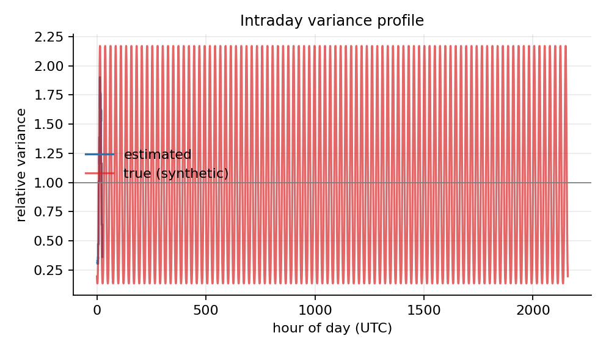
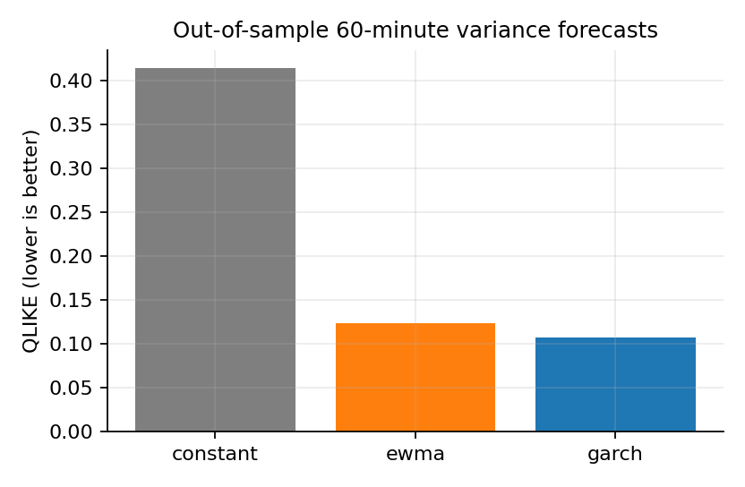

# Validation results (synthetic data)

Generated by `scripts/run_validation.py`. All numbers come from simulated data where the true parameters are known.

## 1. Closed form against Monte Carlo (200,000 paths each)

The same random numbers are used in every row, so the z-scores are correlated.

| kappa_T | E theory | E MC | z-score | std theory | std MC | std rel. error |
|---|---|---|---|---|---|---|
| 0.0 | 1.51e+04 | 1.499e+04 | -1.532 | 3.18e+04 | 3.188e+04 | 0.00264 |
| 0.5 | 1.51e+04 | 1.499e+04 | -1.52 | 3.127e+04 | 3.135e+04 | 0.002604 |
| 1.0 | 1.51e+04 | 1.5e+04 | -1.482 | 2.984e+04 | 2.991e+04 | 0.002498 |
| 2.0 | 1.514e+04 | 1.507e+04 | -1.341 | 2.574e+04 | 2.58e+04 | 0.002098 |
| 4.0 | 1.535e+04 | 1.531e+04 | -0.9308 | 1.902e+04 | 1.904e+04 | 0.0009952 |
| 8.0 | 1.584e+04 | 1.583e+04 | -0.3293 | 1.302e+04 | 1.302e+04 | -0.0003463 |

## 2. Calibration on a simulated market (90 days of 1-minute bars)

| parameter | true | estimated | std error |
|---|---|---|---|
| impact exponent delta | 0.500 | 0.536 | 0.012 |
| temporary share of impact | 0.500 | 0.500 | nan |

Linear fit through the origin: R² = 0.233. The log-log fit of the power law has R² = 0.988 on 25 bins, so a linear impact is clearly the wrong shape when the true exponent is 0.5.

Correlation between the estimated and true intraday variance profile: 0.980.

## 3. Volatility forecasts (out of sample, 60-minute horizon)

| method | QLIKE | vol_RMSE |
|---|---|---|
| constant | 0.4137 | 0.003216 |
| ewma | 0.1238 | 0.001948 |
| garch | 0.1077 | 0.001876 |

GARCH(1,1) on the training part: alpha = 0.048, beta = 0.950, persistence = 0.9976.

## 4. Using the intraday volatility profile

An 8-hour order of 3,000 units. Objective `E + lambda V` without the constant permanent-impact term (which no schedule can change), both schedules evaluated under the volatility that actually applies in the window; lower is better:

| window | controllable cost, constant-vol schedule | controllable cost, intraday-vol schedule | improvement % |
|---|---|---|---|
| starts 02:00 UTC (quiet) | 0.159 | 0.1544 | 2.849 |
| starts 06:00 UTC (volatility rising) | 0.2085 | 0.2079 | 0.2551 |

