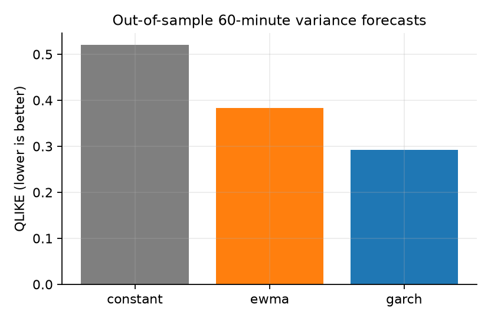
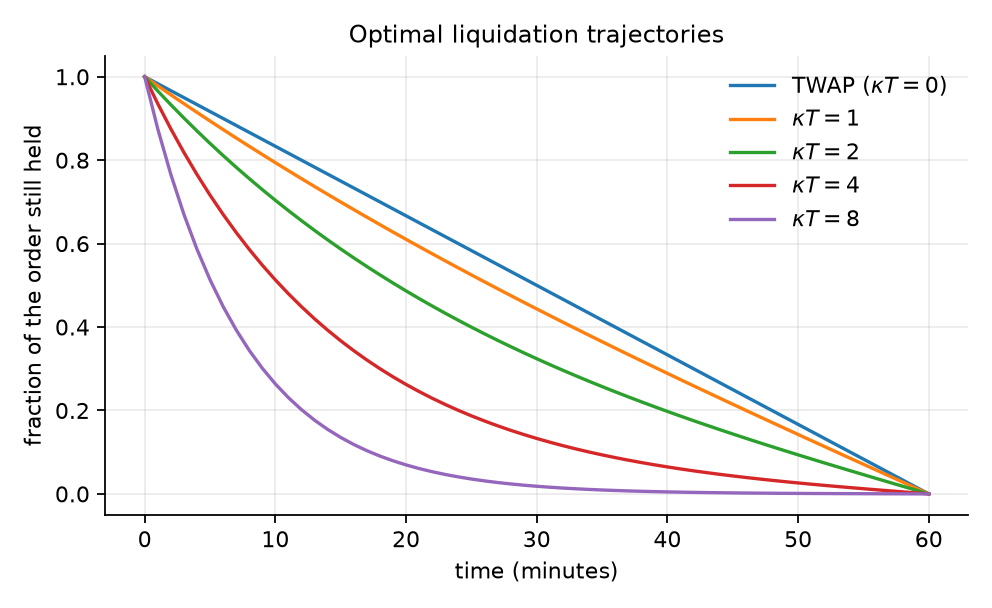

# Real-data results: BTCUSDT

Period: 2026-07-01 to 2026-09-30 (132,480 one-minute bars, 3 files).

## Market impact (aggregate order flow, 1-minute bars)

| quantity | value |
|---|---|
| linear lambda (return per unit) | 1.854e-05 |
| linear t-stat | 14.95 |
| linear R2 | 0.1984 |
| power-law delta | 0.7525 |
| delta std error | 0.02932 |
| power-law log-log R2 | 0.9663 |
| contemporaneous impact | 1.854e-05 |
| next-bar coefficient (negative = reversion) | -4.799e-07 |
| temporary part | 4.799e-07 |
| permanent part | 1.806e-05 |

Readout: delta = 0.752 ± 0.029; the distance from 1 (linear) is 8.4 standard errors. Caveat: aggregate flow mixes price impact with information, see `optexec.calibration`.

## Volatility

Ratio of the highest to the lowest intraday variance bucket: 7.16.

Out-of-sample forecasts of the 60-minute variance (GARCH fitted on the first 60% of the sample):

| method | QLIKE | vol_RMSE |
|---|---|---|
| constant | 0.5203 | 0.001881 |
| ewma | 0.3832 | 0.001535 |
| garch | 0.2925 | 0.001504 |

GARCH(1,1): alpha = 0.054, beta = 0.946, persistence = 0.9999.

## Almgren-Chriss with the calibrated parameters

Order: 33.6 units (10% of the median volume over 60 minutes), one slice per minute. Parameters relative to price: permanent 1.81e-05, temporary 9.93e-06, sigma per minute 0.000488. Shortfall by Monte Carlo with Student-t(5) shocks, in bps of notional:

- The estimated temporary impact (4.8e-07) violates the model's condition eta > gamma*tau/2; it is **floored** at 9.93e-06. This is itself a finding about the model on this data.
| strategy | mean_bps | std_bps | cvar95_bps |
|---|---|---|---|
| TWAP | 3.03 | 21.42 | 47.57 |
| Almgren-Chriss (kappa T = 2) | 3.03 | 17.33 | 39.20 |

Gain from following the intraday volatility profile on an 8-hour order (controllable part of the objective):

| window | improvement_pct |
|---|---|
| starts 02:00 UTC | 0.95 |
| starts 06:00 UTC | 0.57 |
| starts 12:00 UTC | 4.10 |

